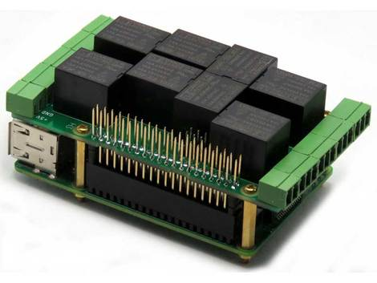

# 8relind-rpi

[](https://www.sequentmicrosystems.com)

[](https://sequentmicrosystems.com/products/eight-relays-stackable-card-for-raspberry-pi)

<h2><a href="https://sequentmicrosystems.com/products/eight-relays-stackable-card-for-raspberry-pi">8-RELAYS Stackable Card for Raspberry Pi</a> by <a href="https://www.sequentmicrosystems.com">Sequent Microsystems</a></h2>

The command line interface (CLI) included in this repository gives you full access to every feature of the card. It is the quickest way to get started and is all you need to operate the card.

If you would rather use a different platform, you can access the same functionality through dedicated, ready-to-use integrations:
- [Python Library](https://github.com/SequentMicrosystems/8relind-rpi/tree/master/python)
- [Node-RED example based on "exec" node](https://github.com/SequentMicrosystems/8relind-rpi/tree/master/node-red)
- [Node-RED "8relind" node](https://github.com/SequentMicrosystems/8relind-rpi/tree/master/node-red-contrib-sm-8relind)
- [Modbus RTU slave](https://github.com/SequentMicrosystems/8relind-rpi/blob/master/MODBUS.md)

*Note: This repository contains the command line and python functions to control Ver. 4 of the card. If you use Ver. 3.x, download from [here](https://github.com/SequentMicrosystems/8relay-rpi). If you have Ver. 1-2 with screw-type connectors, download from [here](https://github.com/SequentMicrosystems/relay8-rpi).*

---

## Prerequisites

<details>
<summary>1. Enable I2C communication</summary>

This only needs to be done once on each Raspberry Pi.

On Raspberry Pi OS, install `raspi-config` first:

```bash
sudo apt update
sudo apt install raspi-config
```

Then run:

```bash
sudo raspi-config
```

Follow the steps in the 3 screenshots below to enable I2C communication. After that, reboot the Raspberry Pi for the changes to take effect.


Reboot the Raspberry Pi:

```bash
sudo reboot
```

</details>

<details>
<summary>2. Install git and build-essential packages</summary>

```bash
sudo apt update
sudo apt install git build-essential
```

</details>

### 1. Enable I2C communication
This only needs to be done once on each Raspberry Pi.

On Raspberry Pi OS, install `raspi-config` first:
```bash
sudo apt update
sudo apt install raspi-config
